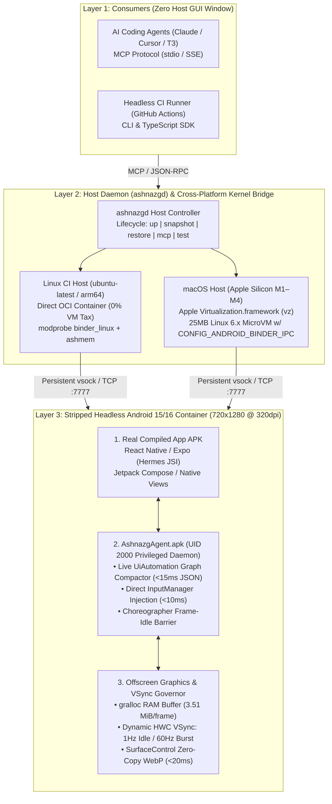
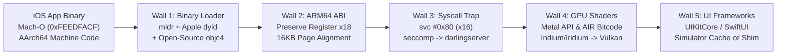

# Ashnazg (`ashnazg`)

> *"Ash nazg durbatulûk, ash nazg gimbatul, ash nazg thrakatulûk, agh burzum-ishi krimpatul."*
> **One Emulator to Rule Them All.**

**Ashnazg** is an open-source, ultra-lightweight, headless mobile runtime and Model Context Protocol (**MCP**) control engine designed to eliminate the two biggest bottlenecks in mobile engineering:
1. **Heavyweight, slow, expensive emulators in CI pipelines and local development** (replacing 4–6 GB RAM, 90-second QEMU cold boots with a **~750 MB RAM, 4-second headless container/microVM**).
2. **Glacial UI inspection and interaction latency for AI Agents and E2E test runners** (replacing 1,500–2,500 ms `adb shell uiautomator dump` + `screencap` process spawns with a **15–30 ms persistent in-memory semantic UI tree + zero-copy WebP frame grabber**).

---

## Table of Contents

1. [Why Ashnazg Exists: The Dual Bottleneck](#1-why-ashnazg-exists-the-dual-bottleneck)
2. [Landscape & The Open-Source Whitespace](#2-landscape--the-open-source-whitespace)
3. [High-Level System Architecture](#3-high-level-system-architecture)
4. [Technical Masterclass: Deep-Dive Internals](#4-technical-masterclass-deep-dive-internals)
   - [Subsystem 01: Linux Kernel, Binder IPC & Shared Memory (`binder_linux`, `ashmem`, `dma_buf`)](#subsystem-01-linux-kernel-binder-ipc--shared-memory)
   - [Subsystem 02: Offscreen Graphics Pipeline (`BufferQueue`, `gralloc`, `SurfaceFlinger`, `hwcomposer`)](#subsystem-02-offscreen-graphics-pipeline--zero-waste-headless-rendering)
   - [Subsystem 03: In-Guest Fast RPC Daemon (`UiAutomation`, `InputManager`, Idle Barrier)](#subsystem-03-in-guest-fast-rpc-daemon-ashnazgagentapk)
   - [Subsystem 04: Digging Through the Bytes — Running iOS Apps on the Same Engine (`Mach-O` → `ELF`)](#subsystem-04-digging-through-the-bytes--running-ios-apps-on-the-same-engine)
5. [MCP & Headless CI Protocol Specification](#5-mcp--headless-ci-protocol-specification)
6. [Hard Engineering Traps & Mitigations](#6-hard-engineering-traps--mitigations)
7. [Phased Implementation Roadmap](#7-phased-implementation-roadmap)

---

## 1. Why Ashnazg Exists: The Dual Bottleneck

Mobile engineering teams and AI coding agents currently hit two distinct walls that often get conflated:

### Bottleneck A: The Runtime Wall (Why Standard Android Emulators Are So Heavy)
The traditional Android Studio Emulator (`qemu-system-aarch64` / Goldfish) emulates an entire physical motherboard, virtual GPU translation layers (`gfxstream` / Angle / VirGL), virtual audio, cellular modems, sensors, and a heavy Qt host GUI window—booting a bloated Google Play Services (GMS) system image.
- **Memory:** 3.5 GB – 6.0 GB RAM per instance.
- **CPU:** 2–4 dedicated vCPUs continuously ticking 60 Hz VSync interrupts even when idle.
- **Cold Boot Time:** 45–120 seconds on CI runners.

### Bottleneck B: The Control Wall (Why `adb` + `uiautomator` Feels Glacial)
Even on a fast machine, existing test frameworks (Maestro, Appium) and current mobile MCP servers rely on shelling out to `adb shell uiautomator dump /sdcard/window_dump.xml` and `adb exec-out screencap -p`.
- Every single UI inspection spawns a new JVM process inside Android, waits for an accessibility idle window, serializes 500+ nested XML nodes to flash storage, and pulls them over ADB—taking **800 ms to 2,500 ms per step**.

### Ashnazg Target Metrics

| Metric | Traditional QEMU AVD + ADB | **Ashnazg Engine** |
| :--- | :--- | :--- |
| **Cold / Warm Boot Time** | 60–120s / 15s | **~4s (Cold) / <1.5s (Snapshot)** |
| **RAM Footprint** | 4.0 GB – 6.0 GB | **~650 MB – 950 MB** |
| **Idle Host CPU Usage** | 15% – 40% (60 Hz continuous VSync) | **< 1% CPU (Dynamic 1 Hz VSync Governor)** |
| **UI Tree + Action Latency** | 1,200 ms – 2,500 ms (`uiautomator dump`) | **15 ms – 30 ms (In-Memory Persistent RPC)** |
| **On-Demand Screenshot** | 500 ms – 900 ms (`adb screencap` PNG) | **15 ms – 25 ms (Zero-Copy `SurfaceControl` WebP)** |
| **Host GUI Window Required?** | Yes (or unoptimized `-no-window`) | **None (100% Offscreen Virtual Framebuffer)** |

---

## 2. Landscape & The Open-Source Whitespace

| Solution | Architecture | Boot / RAM | Runs Real RN / Compose APKs? | macOS (Apple Silicon) | Linux CI (`ubuntu-latest`) | Why It Doesn't Solve the Problem Alone |
| :--- | :--- | :--- | :--- | :--- | :--- | :--- |
| **Android Emulator (Goldfish)** | Full QEMU VM | 45–90s / 4 GB+ | Yes | Native (`Hypervisor.framework`) | Needs KVM + slow | Massive CPU/RAM footprint; slow CI cold boots. |
| **Google Cuttlefish** | `crosvm` / QEMU + virtio | 20–35s / 2–3 GB | Yes | Partial (Meta `cuttlefish-wearables` patches) | Yes (`setup-cuttlefish`) | Built for AOSP OS kernel engineers, not app devs; multi-GB host packages and complex networking. |
| **ReDroid (Remote-Android)** | Docker/OCI Container sharing Linux kernel | **4–8s / ~800 MB** | **Yes** | **Breaks on standard Docker Desktop** (missing `binder_linux` kernel module) | **Yes** (`--privileged` + `modprobe binder_linux`) | Zero developer UX on macOS; un-throttled 60 FPS background compositing; still relies on slow ADB commands. |
| **Waydroid** | LXC Container + Wayland | 5s / ~800 MB | Yes | No (Linux desktop only) | Hard (coupled to Wayland desktop session) | Built for Linux desktop users running Android apps, not headless CI or macOS. |
| **Robolectric / Paparazzi** | JVM Framework Stubs / LayoutLib | <2s / 500 MB | **No** (no RN C++/Hermes JSI or real native runtime) | Yes | Yes | Cannot run React Native / Expo apps, Flutter, or real compiled APKs. |
| **Existing Mobile MCPs** | ADB wrapper around existing emulator | N/A | Yes | Yes | No CI story | Wraps slow `adb` / screenshot calls without fixing the heavy runtime underneath. |

### The Whitespace Ashnazg Fills
No open-source project combines:
1. **A zero-config headless container/microVM runtime** that runs natively as an OCI container on Linux CI **and** boots seamlessly inside a 25 MB `Virtualization.framework` Linux microVM (with `binder_linux` + `ashmem` built into the kernel) on macOS Apple Silicon.
2. **A dynamic offscreen graphics governor** (1 Hz idle VSync, 60 Hz burst on interaction, instant zero-copy WebP screenshots).
3. **A persistent, sub-20ms in-guest RPC daemon** exposing both **MCP** (for local AI agents) and a **deterministic headless test runner** (for CI pipelines).

---

## 3. High-Level System Architecture



---

## 4. Technical Masterclass: Deep-Dive Internals

### Subsystem 01: Linux Kernel, Binder IPC & Shared Memory

Why does an Android binary crash in microseconds if you try to run it inside a standard `ubuntu:24.04` Docker container? Because Android replaced the standard GNU/Linux userland (`glibc`, `SysV IPC`, `D-Bus`, `X11`/`Wayland`) with custom kernel mechanisms:

#### 1A. The `Binder` IPC Driver (`/dev/binder`, `/dev/hwbinder`, `/dev/vndbinder`)
In standard Linux, pipes and sockets require **two memory copies**:
`Process A User Space` $\rightarrow$ `Kernel Space Buffer` $\rightarrow$ `Process B User Space`.

In Android, every intent, window token, permission check, and UI accessibility query crosses between the App process, `system_server`, and `SurfaceFlinger` hundreds of times per second. Binder achieves **1-copy IPC**:
1. When `SurfaceFlinger` or `system_server` starts, it opens `/dev/binder` and calls `mmap(NULL, 1048576, PROT_READ, MAP_PRIVATE, fd, 0)`.
2. The Linux kernel allocates physical RAM pages and maps them **simultaneously** into the kernel's virtual address space **and** as read-only pages inside the receiver's user address space.
3. When your app sends a Parcel via `ioctl(binder_fd, BINDER_WRITE_READ, &bwr)`, the kernel copies the payload **once** from the sender straight into that shared physical page. The receiver reads it immediately with zero second copy.

```text
ioctl(fd, BINDER_WRITE_READ, &bwr)
├── /dev/binder     (Framework & App <-> system_server)
├── /dev/hwbinder   (Framework <-> HIDL/AIDL Hardware Abstraction Layers)
└── /dev/vndbinder  (Vendor Service <-> Vendor Service)
```

#### 1B. Passing Megabytes Without Copying a Single Byte (`ashmem` / `memfd` + `dma_buf`)
Even a single memory copy is too expensive for graphic buffers (`3.51 MiB` per frame $\times 60\text{ fps} = 210\text{ MiB/s}$).
- Android allocates graphic buffers in anonymous shared memory (`ashmem` or `memfd_create("gralloc_buf", MFD_ALLOW_SEALING)`) or a kernel `dma_buf`, returning a standard 32-bit file descriptor (`fd`).
- The producer sends a `flat_binder_object` with `type = BINDER_TYPE_FD` over `/dev/binder`.
- The `binder_linux` kernel driver intercepts the file descriptor inside the `ioctl`, resolves the underlying `struct file *` in the sender's fd table, installs a **new file descriptor** pointing to the **exact same physical RAM pages** into the receiver's fd table, and rewrites the integer inside the Binder parcel. Both processes now `mmap` the exact same physical RAM.

#### 1C. Host OS Unification: Linux CI vs. macOS Apple Silicon
- **On Linux CI (`ubuntu-24.04` / `ubuntu-24.04-arm`):** The host already runs a Linux 6.x kernel. Running `sudo modprobe binder_linux devices="binder,hwbinder,vndbinder"` mounts `/dev/binderfs` in 50 ms. The Android container shares the host kernel with **0% hypervisor overhead**.
- **On macOS (Apple Silicon M1–M4):** macOS runs Apple's **XNU kernel**, which lacks `/dev/binder`, and Docker Desktop's default Linux VM omits `CONFIG_ANDROID_BINDER_IPC`. Ashnazg embeds a lightweight **Apple `Virtualization.framework` (`vz`) launcher** that boots a **25 MB custom Linux 6.x kernel** compiled with:
  - `CONFIG_ANDROID_BINDER_IPC=y`
  - `CONFIG_ANDROID_BINDERFS=y`
  - `CONFIG_ASHMEM=y`
  - `CONFIG_ARM64_16K_PAGES=y` (matching Apple Silicon's hardware page size)
  The microVM boots in **~1.8 seconds** and executes ARM64 Android instructions natively on Apple Silicon CPU cores via Hypervisor.framework (`HVF`).

---

### Subsystem 02: Offscreen Graphics Pipeline & Zero-Waste Headless Rendering

To an Android application (React Native, Jetpack Compose, or XML Views), **"a screen" is just an in-memory `gralloc` buffer** managed by `SurfaceFlinger`. Apps never interact with a physical monitor or a host desktop window.

```text
[App Process: Compose / React Native]
       │  draws via Skia / Vulkan / OpenGL ES (RenderThread)
       ▼
[BufferQueue (IGraphicBufferProducer -> gralloc shared RAM)]
       │  passes dma_buf / memfd handle via Binder IPC
       ▼
[SurfaceFlinger (Android System Compositor)]
       │  hands composited virtual display frame to
       ▼
[Hardware Composer HAL (hwcomposer.ashnazg / redroid)]
       ├── Traditional Emulator: Streams 60 FPS over virtual PCI to Qt Host Window (Heavy!)
       └── Ashnazg Headless:     Keeps pointer in RAM; throttles VSync to 1 Hz when idle
```

#### 2A. The Byte Math of the `720x1280` Offscreen Framebuffer
Why `720x1280` at `320 dpi` (`xhdpi`)?
- In Android's density-independent pixel (`dp`) math: $\text{dp} = \text{px} \times \frac{160}{\text{dpi}}$.
- At `320 dpi`, `720x1280` pixels equals **`360x640 dp`**—the exact logical viewport width of standard modern phones (`1080x2400` @ `480 dpi` is also `360 dp` wide!). Every responsive breakpoint in Jetpack Compose and React Native Flexbox lays out identically.
- Yet the pixel count drops from `2,592,000` pixels (`1080x2400`) to `921,600` pixels (**64.5% fewer pixels to shade**):
  - **Pixel Format:** `PIXEL_FORMAT_RGBA_8888` = $4\text{ bytes/pixel}$.
  - **Row Stride:** $720 \times 4 = 2,880\text{ bytes/row}$.
  - **Single Frame Size:** $2,880 \times 1,280 = 3,686,400\text{ bytes}$ (**$3.51\text{ MiB}$**).
  - **Triple-Buffered Surface Queue:** $3 \times 3.51\text{ MiB} = \mathbf{10.54\text{ MiB}}$ total RAM per window.

#### 2B. Dynamic VSync Throttling ("1 Hz Idle, 60 Hz on Action")
Why do `emulator -no-window` and stock ReDroid still burn CPU when nothing is happening? Because Android's virtual `hwcomposer` fires a simulated hardware VSync interrupt **every 16.6 ms (60 Hz)** forever. If an app has a blinking cursor or spinning loader, `RenderThread` and `SwiftShader` (CPU Vulkan rasterizer) shade millions of pixels 60 times a second into a buffer nobody is viewing.

Ashnazg controls the virtual `hwcomposer` VSync period dynamically:
1. **Idle State (`1 Hz` VSync / `1000 ms` period):** When waiting between test steps or LLM tool calls, VSync ticks once per second (preventing system `Choreographer` timeouts) while keeping host CPU below **1%**.
2. **Interaction Burst (`60 Hz` VSync / `16.6 ms` period for `300 ms`):** The microsecond `AshnazgAgent` injects a `tap`, `scroll`, or `type` event, it switches VSync to 60 Hz until the UI frame barrier settles.
3. **Instant Frame Flush on `screenshot()`:** Triggers an immediate VSync composition pass and reads the `HardwareBuffer`.

#### 2C. Zero-Copy In-Memory Screenshot Capture (~18 ms vs. ~600 ms)
Instead of spawning `adb shell screencap -p` (which forks a process, reads `SurfaceFlinger`, compresses PNG single-threaded, and pipes over USB/TCP), `AshnazgAgent` holds a persistent handle inside the guest:
```kotlin
val captureArgs = DisplayCaptureArgs.Builder(displayToken)
    .setSize(720, 1280)
    .build()
val buffer: ScreenCapture.ScreenshotHardwareBuffer = SurfaceControl.captureDisplay(captureArgs)
val bitmap = Bitmap.wrapHardwareBuffer(buffer.hardwareBuffer, buffer.colorSpace)
bitmap.compress(Bitmap.CompressFormat.WEBP_LOSSY, 80, socketOutputStream)
```
- Encodes a 720p WebP (~35–50 KB) in **15–22 ms** directly into the socket stream with zero disk I/O.
- **Set-of-Marks (SoM) Overlay Mode:** Because the daemon simultaneously holds the live `AccessibilityNodeInfo` bounds and the `Bitmap` in memory, it can optionally draw numbered bounding boxes (`[1]`, `[2]`, `[3]`) on interactive elements before encoding WebP—allowing vision LLMs to execute `tap(mark=3)` deterministically without guessing `(x, y)` coordinates.

---

### Subsystem 03: In-Guest Fast RPC Daemon (`AshnazgAgent.apk`)

`AshnazgAgent` runs as a persistent privileged process (`UID 2000 / shell` or system service) listening on vsock / TCP `:7777`.

#### 3A. Live Accessibility Graph Compaction (<15 ms)
Raw Android View hierarchies routinely contain 500–800 nested layout nodes (`FrameLayout` $\rightarrow$ `LinearLayout` $\rightarrow$ `ReactRootView` $\rightarrow$ `ReactViewGroup` $\times 10$). Dumping them via `uiautomator` takes ~1.5 seconds and wastes thousands of LLM context tokens.

`AshnazgAgent` maintains a live `UiAutomation` connection with:
- `UiAutomation.FLAG_RETRIEVE_INTERACTIVE_WINDOWS`
- `UiAutomation.FLAG_INCLUDE_NOT_IMPORTANT_VIEWS` (essential so React Native `testID`s on non-focusable `View`s and Jetpack Compose `Modifier.testTag` semantics in `AccessibilityNodeInfo.extras["androidx.compose.ui.semantics.testTag"]` are never hidden).

It walks the in-memory node tree, prunes unlabelled wrapper nodes, and emits a compact semantic JSON array in **~11 ms**:
```json
[
  { "id": 1, "role": "heading", "text": "Checkout", "rect": [32, 80, 240, 120] },
  { "id": 2, "testId": "promo-input", "role": "textbox", "text": "", "focused": false, "rect": [32, 160, 688, 220] },
  { "id": 3, "testId": "pay-btn", "role": "button", "text": "Pay $24.00", "enabled": true, "rect": [32, 1100, 688, 1180] }
]
```

#### 3B. Direct Input Injection & Frame-Idle Synchronization
When executing `tap(testId="pay-btn")`:
1. Resolves target center coordinates `(360, 1140)` in memory.
2. Boosts HWC VSync governor to `60 Hz`.
3. Synthesizes `MotionEvent.ACTION_DOWN` and `MotionEvent.ACTION_UP` directly into `InputManager.getInstance().injectInputEvent(event, INJECT_INPUT_EVENT_MODE_WAIT_FOR_RESULT)`.
4. Awaits an internal **Idle Barrier** (monitoring `AccessibilityEvent` quiet window of `120 ms` + `Choreographer` frame completion) and returns the **post-action semantic UI tree** in the same RPC response.

---

### Subsystem 04: Digging Through the Bytes — Running iOS Apps on the Same Engine

Can we go beyond Android APKs and make **iOS applications** run on this same lightweight engine by translating their bytes and syscalls?

Let's examine what happens at the byte and register level, building on prior art from **Darling (`darlinghq`)**, **Indium / Iridium**, **Columbia University's Cider / Cycada**, **touchHLE**, and **QEMU-t8030 / Inferno**.

#### 4A. The Starting Advantage: Identical ARM64 CPU Instructions (`AArch64`)
When you compile Swift, Objective-C, C++, or Rust for an iPhone (`arm64-apple-ios`) and for an ARM64 Linux/Android container (`aarch64-linux-android`), the CPU instructions inside the code section (`__text` vs `.text`) are **100% identical ARMv8-A (`AArch64`) machine code**:
```hex
FF 43 00 D1   ->  sub sp, sp, #0x10
FD 7B 01 A9   ->  stp x29, x30, [sp, #0x10]
00 00 80 52   ->  mov w0, #0
```
Because the CPU instruction set is identical, **zero CPU instruction emulation or JIT translation is required** on Apple Silicon or ARM64 Linux CI runners. The CPU can execute the raw bytes at native hardware speed.

#### 4B. The 5 Byte-Level & OS-Level Walls Between an iOS Binary and Linux/Android



##### Wall 1: The Binary Envelope (`Mach-O` `0xFEEDFACF` vs. `ELF` `0x7F 'E' 'L' 'F'`)
- **The Bytes:** Linux expects `ELF` binaries starting with `7F 45 4C 46`. iOS binaries are **Mach-O** executables starting with `CF FA ED FE` (`0xFEEDFACF`), structured around `LC_SEGMENT_64` (`__TEXT`, `__DATA`, `__LINKEDIT`), `LC_DYLD_CHAINED_FIXUPS`, and `LC_LOAD_DYLIB`.
- **The Solution (Solved in Open Source):** Using Linux's `binfmt_misc` kernel facility, any file beginning with `\xcf\xfa\xed\xfe` is routed to a Mach-O loader (`mldr`). Apple's dynamic linker (**`dyld`**) and Objective-C runtime (**`objc4` / `libobjc.A.dylib`**, including `objc_msgSend`) are open-source (`opensource.apple.com`) and already ported to Linux by the **Darling** project.

##### Wall 2: Two Sneaky ARM64 Hardware ABI Divergences (`x18` & `16 KB` Pages)
1. **Register `x18` (Platform Register):** Apple's ARM64 ABI reserves `x18` exclusively for kernel/pthread state and forbids user code from modifying it. Standard Linux/Android toolchains sometimes use `x18` as a scratch register or Shadow Call Stack pointer.
   - *Fix:* Every trampoline crossing between Mach-O code and Linux ELF shims must save/restore `x18`, and host shim libraries are compiled with `-ffixed-x18`.
2. **Page Size (`16 KB` vs `4 KB`):** iOS segments align on `16 KB` (`0x4000`) boundaries.
   - *Fix:* Mapping `16 KB`-aligned segments on a `4 KB` Linux kernel works cleanly (since $16\text{ KB} = 4 \times 4\text{ KB}$), or the microVM kernel is compiled with `CONFIG_ARM64_16K_PAGES=y`.

##### Wall 3: The Syscall Instruction (`svc #0x80` — XNU Kernel vs. Linux Kernel)
When an iOS binary invokes the kernel, it executes:
```asm
mov x16, #0x2000004   ; XNU BSD syscall #4 = write()
svc #0x80             ; Supervisor Call
```
- **Linux** expects the syscall number in register **`x8`** and `svc #0`.
- **iOS (XNU)** places the syscall number in **`x16`** and splits calls into two namespaces:
  - **BSD Syscalls (`0x2000000` prefix):** POSIX operations (`open`, `read`, `write`, `mmap`, `kqueue`).
  - **Mach Traps (`0x1000000` prefix / negative numbers):** `mach_msg_trap` (`-31`), `vm_allocate`, `semaphore_wait_trap`.
- **The Solution:** Using Linux **`seccomp_unotify` (`SECCOMP_RET_USER_NOTIF`)** or load-time binary rewriting of `svc #0x80` instructions (`01 10 00 D4` in hex) into a fast userspace trampoline:
  - BSD syscalls translate flags in-process, move the syscall ID into `x8`, and invoke the Linux kernel directly.
  - Mach traps route to `darlingserver` (or map Mach ports directly onto `/dev/binder` IPC).

##### Wall 4: Graphics & Shader Translation (Metal `AIR` $\rightarrow$ Vulkan `SPIR-V`)
Modern iOS apps render via `CoreAnimation` $\rightarrow$ `Metal` (`MTLDevice`, `MTLCommandBuffer`, and compiled `.metallib` `AIR` bitcode shaders).
- **The Solution (`Indium` + `Iridium`):** While **MoltenVK** translates Vulkan $\rightarrow$ Metal, **Indium** (`darlinghq/indium`) and **Iridium** (`air2spirv`) do the exact reverse: implementing `Metal.framework` on top of **Vulkan 1.3** and transpiling Apple `AIR` LLVM bitcode into Vulkan `SPIR-V` shaders that execute on our headless `SwiftShader` / `virgl` framebuffer.

##### Wall 5: The Real Boss Fight — Closed-Source `UIKitCore` & `SwiftUI`
Unlike Android (where AOSP open-sources `android.view.*` and Jetpack Compose), Apple keeps `UIKitCore`, `SwiftUI`, and `BackBoardServices` proprietary.
- **How Ashnazg Approaches iOS Support Pragmatically:**
  1. **Track 1 — Cross-Platform Shared Runtime (Works Today for 85%+ of Teams):** React Native / Expo and Flutter apps share 95–99% of their JS/Dart/C++ code across iOS and Android. Running the Android build on Ashnazg's Linux container validates shared flows in CI in 4 seconds; on macOS hosts, Ashnazg drives **headless `CoreSimulator`** (`simctl` without `Simulator.app` GUI, using offscreen `IOSurface` buffers) through the **exact same MCP & CI protocol**.
  2. **Track 2 — Experimental `ashnazg-darwin` Lab (Mach-O on Linux):** Combines Darling's `mldr`/`dyld`/`objc4` + `seccomp` syscall trampoline + `Indium` Metal-to-Vulkan, loading either clean-room `UIKit` stubs (inspired by `touchHLE`) or mounting an extracted iOS Simulator `dyld_shared_cache` with a headless `BackBoardd` shim.

#### Summary Matrix: iOS-on-Linux Technical Readiness

| Layer | Open-Source Foundation | Mechanism | Status |
| :--- | :--- | :--- | :--- |
| **1. CPU Execution** | Native ARMv8-A (`AArch64`) | Direct hardware execution on Apple Silicon & ARM64 Linux CI | **Solved (Native)** |
| **2. Mach-O & Obj-C Runtime** | **Darling** (`mldr`, `dyld`, `objc4`) | Parses `0xFEEDFACF`, binds symbols, runs Apple's open-source `objc_msgSend` | **Solved (Open Source)** |
| **3. XNU BSD & Mach Syscalls** | **`darlingserver`** / `seccomp_unotify` | Traps `svc #0x80` (`x16`), maps BSD calls to Linux & Mach ports to IPC | **Working (Needs iOS tuning)** |
| **4. Metal GPU → Vulkan** | **Indium + Iridium** (`air2spirv`) | Wraps `MTLDevice` over Vulkan 1.3; transpiles `AIR` shaders to `SPIR-V` | **Active R&D (Alpha)** |
| **5. 64-bit UIKit / SwiftUI** | Simulator `dyld_shared_cache` / **touchHLE** | Either clean-room UIKit shim or hosting Simulator `dyld_shared_cache` | **Hard Research Frontier** |

---

## 5. MCP & Headless CI Protocol Specification

Ashnazg exposes a unified control surface for both AI agents (via Model Context Protocol) and deterministic CI test suites:

### Core MCP Tools (`ashnazg mcp`)

| Tool Name | Arguments |Latency | Description |
| :--- | :--- | :--- | :--- |
| `device_boot` | `{ platform, viewport, snapshot? }` | `1.5s–4s` | Boots or restores a warm headless container/simulator snapshot. |
| `ui_snapshot` | `{ includeInvisible?: boolean }` | `~12 ms` | Returns the pruned semantic JSON accessibility tree (`id`, `testId`, `role`, `text`, `rect`, `state`). |
| `ui_act` | `{ action, target, text?, direction? }` | `~25 ms` | Executes `tap`, `long_press`, `type`, `clear`, `scroll_to`, `back`, or `deep_link`, awaits the frame-idle barrier, and returns the updated UI tree. |
| `ui_screenshot` | `{ format?: "webp"\|"png", somOverlay?: boolean }` | `~18 ms` | Grabs a zero-copy offscreen frame from `SurfaceControl` (with optional Set-of-Marks `[1]`, `[2]` badges for vision LLMs). |
| `app_install` | `{ path: string, launch?: boolean }` | `~800 ms` | Streams APK/app bundle into the container and optionally launches the main activity. |
| `app_logs` | `{ tagFilter?: string, sinceMs?: number }` | `~5 ms` | Streams ring-buffered crash logs, `ReactNativeJS` console output, and ANR traces. |

---

## 6. Hard Engineering Traps & Mitigations

1. **ABI Matching (`arm64-v8a` vs `x86_64`) in CI:**
   - Local Apple Silicon Macs build and run `arm64-v8a`. Standard GitHub Actions `ubuntu-24.04-arm` runners are **native ARM64** and free for public repos (and cheaper than `x86_64` on private repos). Defaulting CI workflows to `ubuntu-24.04-arm` eliminates `libndk_translation` overhead and runs React Native's Hermes + C++ TurboModules at native speed.
2. **Compose & React Native Accessibility Node Visibility:**
   - React Native collapses layout-only views unless queried with `FLAG_INCLUDE_NOT_IMPORTANT_VIEWS`.
   - Jetpack Compose stores `Modifier.testTag("...")` in `AccessibilityNodeInfo.extras` (`"androidx.compose.ui.semantics.testTag"`) when `testTagsAsResourceId` is not enabled. `AshnazgAgent` inspects both `viewIdResourceName` and the Compose semantics extras bundle automatically.
3. **Google Play Services (GMS) Dependencies:**
   - Stripping proprietary GMS saves ~1.5 GB RAM and 30s of boot time. For apps requiring Maps, Push, or Auth tokens during E2E tests, Ashnazg supports an optional lightweight **microG (`GmsCore`)** overlay (+120 MB RAM).

---

## 7. Phased Implementation Roadmap

### Milestone 1: The In-Guest Fast RPC Daemon & MCP Server (`v0.1`)
- [ ] Build `agent-android` (`AshnazgAgent.apk`) in Kotlin with persistent `UiAutomation` tree compaction, Compose `testTag` + RN `testID` extraction, direct `InputManager` event injection, frame-idle synchronization, and `SurfaceControl` WebP capture.
- [ ] Build `ashnazg-mcp` (TypeScript/Go) exposing `ui_snapshot`, `ui_act`, `ui_screenshot` (with Set-of-Marks), and `app_logs` over MCP stdio/SSE.
- [ ] Benchmark against stock `adb shell uiautomator dump` (target: **>40x speedup** per step).

### Milestone 2: Stripped Headless Android Container & GitHub Action (`v0.2`)
- [ ] Build custom headless ReDroid-based container image (`ashnazg/android:15-arm64` & `15-amd64`) pre-configured at `720x1280` @ `320 dpi`, animations disabled, bloat stripped, dynamic 1 Hz / 60 Hz VSync governor, and `AshnazgAgent.apk` pre-installed.
- [ ] Publish reusable GitHub Action (`edufelip/ashnazg-action`) that loads `binder_linux`, boots the headless container in ~4s, and runs deterministic E2E test flows.

### Milestone 3: Zero-Setup macOS Apple Silicon MicroVM Launcher (`v0.3`)
- [ ] Package a single-command macOS launcher (`ashnazg up`) powered by Apple `Virtualization.framework` with a pre-built 25 MB Linux 6.x kernel (`CONFIG_ANDROID_BINDER_IPC=y`, `CONFIG_ASHMEM=y`) so macOS developers never have to configure UTM or custom Docker Desktop kernels.

### Milestone 4: Unified Headless iOS Simulator Bridge & `ashnazg-darwin` Lab (`v0.4+`)
- [ ] Add headless macOS `CoreSimulator` backend (`IOSurface` zero-copy WebP capture + `AXElement` fast socket agent) behind the identical `ashnazg` MCP and CI test runner interface.
- [ ] Experimental R&D track (`ashnazg-darwin`): prototype running ARM64 iOS Mach-O binaries inside the Linux container via Darling `mldr`/`dyld` + `seccomp_unotify` syscall translation + Indium Metal-to-Vulkan.

---

## License

MIT
